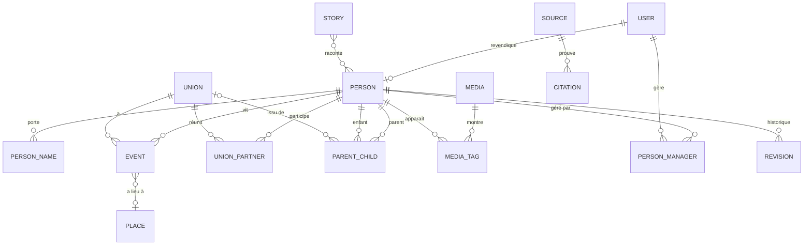
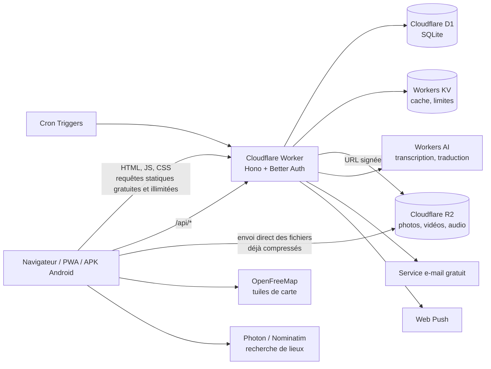
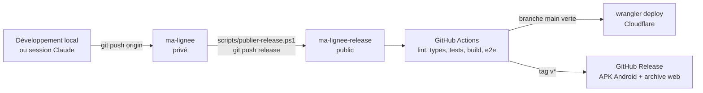
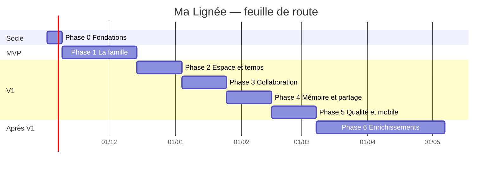

# Ma Lignée — Analyse complète & plan d'implémentation

> Application de généalogie collaborative, 100 % gratuite, belle et animée.
> Document de référence du projet — version 1.0 du 26 octobre 2026.

---

## Sommaire

1. [Résumé](#1-résumé)
2. [Vision et concept](#2-vision-et-concept)
3. [Utilisateurs et cas d'usage](#3-utilisateurs-et-cas-dusage)
4. [Analyse des concurrents](#4-analyse-des-concurrents)
5. [Catalogue complet des fonctionnalités](#5-catalogue-complet-des-fonctionnalités)
6. [Modèle de données](#6-modèle-de-données)
7. [Architecture technique 100 % gratuite](#7-architecture-technique-100--gratuite)
8. [Direction artistique et animations](#8-direction-artistique-et-animations)
9. [Dépôts GitHub et CI/CD](#9-dépôts-github-et-cicd)
10. [Plan d'implémentation par phases](#10-plan-dimplémentation-par-phases)
11. [Ressources à installer et à télécharger](#11-ressources-à-installer-et-à-télécharger)
12. [Risques et parades](#12-risques-et-parades)
13. [Prochaines étapes](#13-prochaines-étapes)
14. [Sources](#14-sources)

---

## 1. Résumé

**Ma Lignée** permet à chacun de s'inscrire, de se rattacher à sa famille et de voir immédiatement
ses parents, frères et sœurs, grands-parents, arrière-grands-parents, oncles, cousins… puis de
**remonter (ou descendre) la lignée jusqu'à une époque choisie** (« montre-moi mes ancêtres jusqu'en 1850 »).
Chaque personne a un profil riche (photos, vidéos, audios, documents, récits), chaque lieu apparaît sur
une **carte animée des migrations**, et chaque vie sur une **frise chronologique**.

Ce qui distingue Ma Lignée des leaders (Ancestry, MyHeritage, FamilySearch, Geneanet) :

| Axe | Les leaders | Ma Lignée |
|---|---|---|
| Prix | Abonnements payants, fonctions bridées en gratuit | **Tout gratuit, sans limite de fonctionnalités** |
| Expérience | Interfaces denses, datées | **Interface moderne, animée, mobile d'abord** |
| Structures familiales | Pensées pour la famille occidentale | **Polygamie, unions coutumières, adoption, tutelle, familles recomposées** |
| Mémoire | Centrée sur les archives écrites | **Tradition orale : enregistrements audio, récits, noms de louange, totems, devises** |
| Rattachement | Chacun construit son arbre dans son coin | **Arbre partagé : on revendique son profil et on se raccorde à la famille** |
| Temps & espace | Carte et frise secondaires | **« Voyage dans le temps » : curseur d'époque qui anime l'arbre et la carte ensemble** |
| Connexion | Lourd | **Économe en données, hors-ligne (PWA)** |

**Pile technique retenue (100 % gratuite)** : React + Vite (PWA) servi par **Cloudflare Workers**,
API **Hono** sur Workers, base **Cloudflare D1** (SQLite), fichiers sur **Cloudflare R2**,
authentification **Better Auth**, carte **MapLibre + OpenFreeMap**, arbre **D3 / family-chart**,
animations **Motion**. Code source dans un dépôt **privé**, compilation/tests/déploiement dans un dépôt
**public** (minutes GitHub Actions illimitées sur les runners standards des dépôts publics).

**Durée estimée** : environ 4 à 5 mois pour une V1 complète, avec un MVP utilisable vers la semaine 6.

---

## 2. Vision et concept

### 2.1 La promesse

> « Je m'inscris, et en quelques minutes je vois toute ma famille, jusqu'à mes arrière-arrière-grands-parents,
> avec leurs visages, leurs voix, leurs histoires et les chemins qu'ils ont parcourus. »

### 2.2 Le concept clé : un arbre partagé, pas des arbres isolés

Deux modèles existent sur le marché :

- **Arbres individuels** (Ancestry, MyHeritage, Geneanet) : chacun construit son propre arbre, les mêmes
  ancêtres sont saisis des milliers de fois, les « correspondances » servent à relier les arbres.
- **Arbre mondial unique** (FamilySearch, Geni, WikiTree) : une seule fiche par personne réelle,
  modifiée collaborativement.

**Ma Lignée adopte l'arbre unique**, avec des garde-fous :

- Chaque personne réelle = **un seul profil**.
- Un membre de la famille déjà inscrit **invite** un proche (lien WhatsApp, SMS, e-mail, QR code) :
  le proche s'inscrit et **revendique son profil** qui existe déjà — il voit instantanément toute sa famille.
- Un nouvel inscrit sans invitation **recherche** ses parents ; s'il les trouve, il envoie une
  **demande de rattachement** validée par un gestionnaire de la famille.
- Les profils des **personnes vivantes sont privés par défaut** ; seuls les membres de la famille proche
  les voient.
- Les modifications sur les profils d'autrui passent par des **propositions** (validées par le titulaire
  ou un gestionnaire), avec historique complet et retour arrière.

### 2.3 « Suivre une lignée jusqu'à une époque »

Trois façons de naviguer dans le temps :

1. **Par générations** : « afficher 5 générations d'ancêtres ».
2. **Par date** : « afficher mes ancêtres nés après 1800 » ou « remonter jusqu'en 1850 ».
3. **Voyage dans le temps** : un curseur d'année (ex. 1750 → aujourd'hui) qui **anime** l'arbre (les
   personnes apparaissent à leur naissance, s'estompent à leur décès) et **synchronise la carte**
   (les points apparaissent là où vivait la famille cette année-là, les migrations se dessinent).

On peut aussi suivre une **lignée précise** : patrilinéaire (de père en père), matrilinéaire
(de mère en mère), ou le chemin entre deux personnes (« comment suis-je lié à cette personne ? »).

---

## 3. Utilisateurs et cas d'usage

### 3.1 Personas

| Persona | Profil | Besoin principal |
|---|---|---|
| **Le gardien de la mémoire** | 45-70 ans, connaît l'histoire familiale | Saisir l'arbre, raconter, transmettre avant que la mémoire se perde |
| **Le jeune curieux** | 15-35 ans, sur mobile | Découvrir ses origines, voir des photos, partager sur les réseaux |
| **La diaspora** | Vit loin du pays d'origine | Rester relié aux racines, connaître les cousins, le village d'origine |
| **Le chercheur amateur** | Passionné de généalogie | Sources, dates précises, import/export GEDCOM, rigueur |
| **L'aîné** | 70 ans et plus, peu technophile | Être enregistré (voix), regarder les photos, interface très simple |

### 3.2 Parcours essentiels

1. **Inscription par invitation** → revendication de profil → découverte animée de sa famille (« Bienvenue, voici ta famille »).
2. **Inscription sans invitation** → assistant « parlez-nous de vos parents » → création des premiers profils → suggestions de correspondances avec des profils existants.
3. **Ajouter un proche** en 3 taps depuis l'arbre (« + » sur une carte de personne → parent / enfant / conjoint / frère-sœur).
4. **Enrichir un ancêtre** : photos, récit, enregistrement audio d'un aîné.
5. **Explorer** : arbre, éventail, carte, frise, voyage dans le temps.
6. **Comprendre un lien** : « quel est mon lien avec Aïcha ? » → « cousine issue de germain, par votre arrière-grand-père Ali ».
7. **Partager** : carte d'arbre en image, lien public d'un ancêtre décédé, livre de famille PDF.

---

## 4. Analyse des concurrents

> Les prix et volumes indiqués sont indicatifs et évoluent souvent ; à revérifier sur les sites officiels.

### 4.1 Les grandes plateformes commerciales

#### Ancestry (États-Unis)
- **Modèle** : abonnement payant (formules de plusieurs centaines de dollars/an pour l'accès complet) ;
  un compte gratuit permet de construire un arbre mais les archives sont payantes. Propriétaire de Geneanet depuis 2021.
- **Forces** : la plus grande base d'archives (recensements, état civil, registres militaires, migrations),
  « indices » (feuilles vertes) qui proposent des documents, test ADN AncestryDNA avec très grande base de
  testeurs, ThruLines (relie les correspondances ADN aux ancêtres communs), application mobile soignée.
- **Faiblesses** : cher, fortement centré sur l'Amérique du Nord et l'Europe, arbres individuels
  (doublons à l'infini), peu de place pour la mémoire orale.
- **À retenir pour Ma Lignée** : les **indices/suggestions automatiques**, la **fiche « LifeStory »**
  (vie racontée chronologiquement avec contexte historique).

#### MyHeritage (Israël)
- **Modèle** : freemium — l'arbre gratuit est limité (250 personnes, 500 Mo de médias) ; formules payantes
  pour les archives et les fonctions avancées. Propriétaire de **Geni** (2012) et de **Filae** (2021).
- **Forces** : Smart Matches (correspondances entre arbres) et Record Matches, interface traduite dans de
  nombreuses langues, **outils photo par IA** (Deep Nostalgia anime les visages, In Color colorise,
  Photo Enhancer améliore la netteté), test ADN, logiciel Family Tree Builder.
- **Faiblesses** : limites sévères en gratuit, relances commerciales agressives, fonctions IA payantes au-delà de quelques essais.
- **À retenir** : l'**effet « waouh » des photos** (colorisation, animation), les **correspondances intelligentes**.

#### Findmypast (Royaume-Uni) et autres spécialistes régionaux
- Archives britanniques et irlandaises, journaux anciens. Payant. Peu pertinent pour notre public mais
  rappelle l'importance du **contexte historique local**.

### 4.2 Les arbres collaboratifs mondiaux

#### FamilySearch (organisation à but non lucratif)
- **Modèle** : **entièrement gratuit**, financé par l'Église de Jésus-Christ des Saints des Derniers Jours.
- **Forces** : **arbre mondial unique** de plus d'un milliard de personnes, énorme fonds d'archives
  numérisées et indexées par des bénévoles, **Souvenirs** (photos, documents, enregistrements audio,
  histoires), application « Proches autour de moi » (découvrir qu'une personne à côté de soi est un cousin),
  fonction de calcul du lien de parenté.
- **Faiblesses** : n'importe qui peut modifier n'importe quel ancêtre décédé (guerres d'édition),
  interface fonctionnelle mais peu émotionnelle, contexte religieux qui freine certains utilisateurs,
  peu adaptée aux structures familiales non occidentales.
- **À retenir** : **l'arbre unique**, la **gratuité totale**, les **Souvenirs**, « **Proches autour de moi** ».

#### Geni (filiale de MyHeritage)
- **Modèle** : freemium ; base gratuite, abonnement « Pro » pour la recherche avancée et la fusion.
- **Forces** : **arbre mondial** + réseau social familial, invitations de proches, gestionnaires de profils,
  « projets » thématiques.
- **Faiblesses** : interface datée, fonctions de fusion/recherche payantes, conflits de gestion.
- **À retenir** : **inviter ses proches pour qu'ils complètent eux-mêmes**, le **rôle de gestionnaire** de profil.

#### WikiTree
- **Modèle** : **100 % gratuit**, sans offre premium, communauté bénévole.
- **Forces** : arbre unique de type wiki, **sources exigées**, charte d'honneur, protection des profils
  récents, liens avec l'ADN.
- **Faiblesses** : interface « wiki » austère, courbe d'apprentissage, peu de médias.
- **À retenir** : la **culture de la source** et les **niveaux de confiance**.

#### Geneanet (France, propriété d'Ancestry)
- **Modèle** : hébergement d'arbre **gratuit et sans limite de taille** ; abonnement Premium pour la
  recherche avancée, les alertes et la bibliothèque.
- **Forces** : énorme communauté francophone, relevés collaboratifs (état civil, cimetières,
  monuments aux morts), moteur de recherche sur les arbres de tous les membres.
- **Faiblesses** : interface chargée, arbres individuels (doublons), centré France/Europe.
- **À retenir** : la **gratuité de l'arbre**, les **projets collaboratifs** d'indexation, la francophonie.

### 4.3 Outils libres et légers

| Outil | Type | Forces | Faiblesses | À retenir |
|---|---|---|---|---|
| **Family Echo** | Web gratuit | Éditeur d'arbre très simple et rapide, GEDCOM | Basique, peu de médias, publicités | La **saisie en 3 clics** |
| **Gramps / Gramps Web** | Libre, auto-hébergé | Très complet (sources, événements, cartes, médias), collaboratif en version web | Complexe, nécessite un serveur | Le **modèle de données par événements** |
| **webtrees** | Libre (PHP), auto-hébergé | Collaboratif, GEDCOM natif, nombreux graphiques | Installation serveur, look daté | Les **types de graphiques** |
| **Topola** | Visionneuse libre | Beaux graphiques (sablier, ascendants, descendants) à partir d'un GEDCOM | Visionneuse seulement | Le **rendu des graphiques** |
| **family-chart** | Bibliothèque JS (MIT) | Arbre D3 interactif, zoom, édition | À intégrer soi-même | **Base de notre arbre** |

### 4.4 Logiciels de bureau

| Logiciel | Points notables |
|---|---|
| **Heredis** (France) | Payant, très bons graphiques et livres imprimables, application mobile |
| **RootsMagic** | Payant, synchronisation avec FamilySearch/Ancestry |
| **MacFamilyTree** | Payant (Apple), **arbre virtuel 3D**, graphiques très visuels |
| **Family Tree Builder** | Gratuit (MyHeritage), synchronisé avec MyHeritage |

### 4.5 Les « concurrents » informels

Groupes **WhatsApp/Facebook** familiaux, cahiers manuscrits, mémoire des aînés et griots, albums photo
chez les uns et les autres. C'est là que vit réellement la mémoire de beaucoup de familles :
**Ma Lignée doit être aussi facile qu'un groupe WhatsApp** et s'y intégrer (partage de liens, invitations).

### 4.6 Matrice comparative

| Fonction | Ancestry | MyHeritage | FamilySearch | Geni | Geneanet | WikiTree | **Ma Lignée** |
|---|---|---|---|---|---|---|---|
| Gratuit sans limite | ✗ | ✗ | ✓ | ~ | ~ | ✓ | **✓** |
| Arbre unique partagé | ✗ | ✗ | ✓ | ✓ | ✗ | ✓ | **✓** |
| Revendiquer son profil / invitations | ~ | ~ | ~ | ✓ | ✗ | ~ | **✓** |
| Polygamie / unions coutumières | ~ | ~ | ~ | ~ | ~ | ~ | **✓ natif** |
| Tradition orale (audio, récits) | ~ | ~ | ✓ | ~ | ✗ | ✗ | **✓ central** |
| Carte des migrations animée | ~ | ~ | ~ | ✗ | ~ | ✗ | **✓** |
| Voyage dans le temps (curseur d'époque) | ✗ | ✗ | ✗ | ✗ | ✗ | ✗ | **✓ exclusif** |
| Calcul du lien de parenté | ✓ | ✓ | ✓ | ✓ | ✓ | ✓ | **✓** |
| Outils photo IA | ~ | ✓ (payant) | ✗ | ✗ | ✗ | ✗ | **~ (gratuit, local)** |
| Archives historiques massives | ✓ | ✓ | ✓ | ~ | ✓ | ✗ | ✗ (hors périmètre) |
| Test ADN | ✓ | ✓ | ✗ | ~ | ✓ | ~ | ✗ (hors périmètre) |
| Hors-ligne / faible connexion | ~ | ~ | ~ | ✗ | ✗ | ✗ | **✓ (PWA)** |
| Interface moderne et animée | ~ | ~ | ~ | ✗ | ✗ | ✗ | **✓** |

✓ = oui · ~ = partiel ou payant · ✗ = non

### 4.7 Opportunités identifiées

1. **Personne n'est à la fois gratuit, beau et collaboratif.** FamilySearch est gratuit mais austère ;
   MyHeritage est séduisant mais payant.
2. **Les structures familiales non occidentales sont mal servies** : plusieurs épouses simultanées,
   mariages coutumiers, enfants confiés, lignées claniques, noms qui changent selon les étapes de la vie.
3. **La mémoire orale disparaît** : aucun acteur n'en fait son cœur.
4. **L'espace et le temps sont sous-exploités** : cartes et frises existent, mais personne ne les anime ensemble.
5. **Le mobile et la faible connexion** : les leaders sont lourds.

### 4.8 Ce que Ma Lignée ne fera pas (au moins au début)

- **Tests ADN** : impossible gratuitement (laboratoire, logistique, réglementation).
- **Archives historiques numérisées massives** : coûts de stockage et de licences. On permettra en revanche
  d'**ajouter ses propres documents** et de **lier des sources externes** (FamilySearch, archives en ligne).
- **Impression physique** de posters/livres : on génère le PDF, l'utilisateur l'imprime où il veut.

---

## 5. Catalogue complet des fonctionnalités

**Priorités** : **MVP** (indispensable au lancement) · **V1** (version complète) · **V2** (enrichissements) · **V3** (bonus).

### A. Comptes et identité

| # | Fonction | Priorité |
|---|---|---|
| A1 | Inscription par e-mail + mot de passe, ou lien magique par e-mail | MVP |
| A2 | Connexion Google (OAuth gratuit) | MVP |
| A3 | Inscription via lien d'invitation (lien, QR code, partage WhatsApp/SMS) | MVP |
| A4 | Revendication de profil (« Je suis cette personne ») avec validation | MVP |
| A5 | Profil utilisateur : photo, langue, thème clair/sombre | MVP |
| A6 | Passkeys (connexion sans mot de passe par empreinte/visage) | V1 |
| A7 | Connexion par numéro de téléphone (OTP) — dépend d'un service SMS gratuit, à étudier | V3 |
| A8 | Comptes délégués : un enfant gère le profil d'un aîné sans smartphone | V1 |
| A9 | Suppression du compte et export de toutes ses données (RGPD) | V1 |
| A10 | Double authentification (TOTP) | V2 |

### B. Personnes et profils

| # | Fonction | Priorité |
|---|---|---|
| B1 | Fiche personne : prénoms, nom, nom de naissance, sexe, vivant/décédé | MVP |
| B2 | **Noms multiples** : surnoms, noms de louange (oriki, etc.), noms religieux, noms d'initiation, nom d'usage, avec période de validité | V1 |
| B3 | Dates **approximatives** : exacte, « vers 1900 », « avant », « après », « entre 1890 et 1895 », « pendant la saison des pluies 1920 », texte libre conservé | MVP |
| B4 | Événements de vie : naissance, baptême/nom, mariage, décès, inhumation, migration, profession, résidence, initiation, intronisation, diplôme, service militaire… (types personnalisables) | MVP (base) / V1 (tous) |
| B5 | Lieux liés à chaque événement (village, ville, pays) avec position sur la carte | MVP |
| B6 | Photo de profil avec recadrage, et galerie | MVP |
| B7 | Biographie riche (texte mis en forme) | MVP |
| B8 | Attributs culturels : ethnie/peuple, langue, religion, clan, totem, interdits, devise familiale, profession traditionnelle | V1 |
| B9 | Titres et fonctions : chef de famille, chef de village, roi, notable, avec périodes | V1 |
| B10 | Cause de décès (privée), lieu de sépulture avec photo de la tombe et coordonnées GPS | V1 |
| B11 | « Récit de vie » généré automatiquement : la vie racontée chronologiquement avec le contexte historique | V2 |
| B12 | Score de complétude du profil (« ajoutez une photo pour compléter Grand-père à 80 % ») | V1 |

### C. Relations familiales

| # | Fonction | Priorité |
|---|---|---|
| C1 | Parents ↔ enfants | MVP |
| C2 | Unions (conjoints) avec date de début/fin et statut (marié, divorcé, veuf, séparé) | MVP |
| C3 | **Polygamie native** : plusieurs unions simultanées, rang des épouses, enfants rattachés à la bonne union | MVP |
| C4 | Types d'union : civile, religieuse, **coutumière/traditionnelle**, union libre | MVP |
| C5 | Types de filiation : biologique, adoptive, **enfant confié**, tuteur, beau-parent, inconnue | V1 |
| C6 | Demi-frères/sœurs calculés automatiquement (un seul parent commun) | MVP |
| C7 | Jumeaux / triplés (ordre de naissance), rang dans la fratrie | V1 |
| C8 | Parents inconnus et « hypothèses » (lien probable mais non prouvé, affiché en pointillés) | V1 |
| C9 | Liens non familiaux importants : parrain/marraine, homonyme (personne dont on porte le nom), meilleur ami | V2 |
| C10 | Détection d'incohérences : enfant né avant la naissance du parent, mère de 70 ans, boucles dans l'arbre | V1 |

### D. Arbre généalogique et visualisations

| # | Fonction | Priorité |
|---|---|---|
| D1 | **Arbre interactif** centré sur une personne : zoom, déplacement, clic pour recentrer, transitions animées | MVP |
| D2 | Ajout rapide depuis l'arbre (bouton « + » sur une carte → parent/enfant/conjoint/frère-sœur) | MVP |
| D3 | **Vue ascendante** (ancêtres) avec choix du nombre de générations | MVP |
| D4 | **Vue descendante** (descendants) | MVP |
| D5 | **Vue sablier** (ancêtres en haut, descendants en bas) | V1 |
| D6 | **Éventail** (fan chart) circulaire des ancêtres, coloré par branche ou par lieu d'origine | V1 |
| D7 | **Filtre d'époque** : « jusqu'à 1850 », « nés après 1800 », N générations | MVP |
| D8 | **Lignée directe** : patrilinéaire, matrilinéaire, chemin entre deux personnes mis en surbrillance | V1 |
| D9 | **Voyage dans le temps** : curseur d'année qui anime l'apparition/disparition des personnes | V1 |
| D10 | Mini-carte de navigation et recherche dans l'arbre (« aller à… ») | V1 |
| D11 | Couleurs par branche (paternelle/maternelle), par lieu, par statut (vivant/décédé) | V1 |
| D12 | Vue « famille proche » (cartes, idéale sur mobile) | MVP |
| D13 | Vue « toile » (graphe libre de toute la famille élargie) | V2 |
| D14 | Statistiques de lignée : nombre de descendants, espérance de vie par génération, prénoms les plus fréquents, pays | V2 |
| D15 | Export de l'arbre en image (PNG/SVG) et **poster PDF** grand format | V1 |
| D16 | **Arbre 3D** / vue « forêt » (bonus visuel) | V3 |
| D17 | Rendu performant de grands arbres (milliers de personnes) : chargement progressif, rendu canvas | V1 |

### E. Calculateur de parenté

| # | Fonction | Priorité |
|---|---|---|
| E1 | « Quel est mon lien avec X ? » en français naturel : oncle, grand-tante, cousin germain, cousin issu de germain, petit-cousin, arrière-grand-oncle, beau-frère… | MVP |
| E2 | Affichage du **chemin** dans l'arbre (ancêtre commun mis en évidence) | V1 |
| E3 | Gestion des doubles liens (cousins par les deux côtés) | V1 |
| E4 | Badge « relation » sur chaque profil visité (« votre cousine au 2ᵉ degré ») | V1 |
| E5 | « Proches autour de moi » : découvrir qu'un membre présent au même événement (réunion de famille) est un parent | V3 |

### F. Carte

| # | Fonction | Priorité |
|---|---|---|
| F1 | Carte de tous les lieux de la famille (naissances, résidences, décès, sépultures) avec regroupement des points | V1 |
| F2 | **Migrations animées** : arcs qui se dessinent du lieu de naissance vers les lieux de vie | V1 |
| F3 | **Synchronisation avec le voyage dans le temps** : la carte montre où vivait la famille l'année choisie | V1 |
| F4 | Vue **globe 3D** pour la diaspora | V2 |
| F5 | Carte de chaleur des origines | V2 |
| F6 | Fiche de lieu : nom historique / actuel, photos du village, personnes liées, histoire du lieu | V1 |
| F7 | Saisie de lieu assistée (autocomplétion gratuite) et placement manuel sur la carte pour les villages absents | MVP (saisie) |
| F8 | Fonds de carte anciens (cartes historiques libres) superposables | V3 |

### G. Frise chronologique

| # | Fonction | Priorité |
|---|---|---|
| G1 | Frise d'une vie (événements et médias) | V1 |
| G2 | Frise de famille : vies superposées des membres d'une branche | V1 |
| G3 | Contexte historique : grands événements (indépendances, guerres, épidémies…) affichés en arrière-plan | V2 |
| G4 | « Ce jour-là » : ce qui s'est passé dans la famille à la même date les années précédentes | V2 |

### H. Médias (photos, vidéos, audio, documents)

| # | Fonction | Priorité |
|---|---|---|
| H1 | Envoi de photos avec **compression automatique dans le navigateur** (WebP/AVIF) et miniatures | MVP |
| H2 | Galerie par personne, par famille, par événement, par lieu | MVP |
| H3 | **Identifier des personnes sur une photo** (étiquette posée sur le visage) | V1 |
| H4 | Détection des visages **dans le navigateur** (gratuit, sans serveur) pour proposer les étiquettes | V2 |
| H5 | Vidéos courtes avec compression dans le navigateur (720p) + possibilité de **lier une vidéo YouTube non répertoriée** pour les longues | V1 |
| H6 | **Enregistrements audio** (voix des aînés) très légers (Opus), lecture en continu | MVP |
| H7 | Documents : actes, lettres, diplômes (PDF, images), avec transcription | V1 |
| H8 | Albums partagés de famille et diaporama animé (effet Ken Burns) | V1 |
| H9 | Restauration/colorisation de photos anciennes (IA gratuite si quotas suffisants, sinon traitement local) | V3 |
| H10 | Dates et lieux lus dans les métadonnées EXIF des photos | V1 |
| H11 | Quotas de stockage par famille visibles et équitables | MVP |
| H12 | Numérisation guidée de photos papier avec la caméra du téléphone (recadrage auto) | V2 |

### I. Récits et mémoire

| # | Fonction | Priorité |
|---|---|---|
| I1 | Récits : textes illustrés liés à une ou plusieurs personnes | V1 |
| I2 | **Interview guidée d'un aîné** : questions proposées (« Où es-tu né ? Comment as-tu rencontré grand-mère ? »), enregistrement audio par question | V1 |
| I3 | Transcription automatique des enregistrements (IA gratuite dans la limite des quotas) | V2 |
| I4 | Recettes de famille, chants, proverbes, devises, oriki/noms de louange, généalogies récitées | V1 |
| I5 | Capsules temporelles : messages qui s'ouvrent à une date future (ex. pour les 18 ans d'un enfant) | V2 |
| I6 | Pages commémoratives (« in memoriam ») avec messages de la famille | V1 |
| I7 | **Livre de famille PDF** généré automatiquement (couverture, arbre, biographies, photos) | V1 |

### J. Collaboration

| # | Fonction | Priorité |
|---|---|---|
| J1 | Invitations de proches liées à leur profil (lien, QR code, WhatsApp, SMS, e-mail) | MVP |
| J2 | Rôles : titulaire du profil, **gestionnaires** (famille proche), contributeurs, lecteurs | MVP |
| J3 | **Propositions de modification** avec validation par le titulaire/gestionnaire | V1 |
| J4 | **Historique complet** de chaque profil et retour à une version antérieure | V1 |
| J5 | Détection des **doublons** et **fusion** de profils (avec vote/validation et annulation possible) | V1 |
| J6 | Discussions et commentaires sur un profil, une photo, un récit | V1 |
| J7 | Sources et preuves (acte, témoignage oral, photo) avec **niveau de confiance** | V1 |
| J8 | « Espaces de famille » : groupes privés (ex. « Famille Salami ») avec fil d'actualité | V1 |
| J9 | Résolution de conflits : signaler une erreur, médiation par les gestionnaires | V2 |
| J10 | Édition simultanée en temps réel avec présence (« Fatou est aussi en train de modifier ») | V3 |

### K. Confidentialité et sécurité

| # | Fonction | Priorité |
|---|---|---|
| K1 | **Vivants privés par défaut** : visibles seulement par la famille proche connectée | MVP |
| K2 | Niveaux de visibilité par profil et par champ : public, famille élargie, famille proche, moi seul | MVP (profil) / V1 (champ) |
| K3 | Protection renforcée des **mineurs** | MVP |
| K4 | Personnes décédées depuis moins de N années (paramétrable) traitées comme sensibles | V1 |
| K5 | Profils publics partageables pour les ancêtres décédés (page lisible sans compte) | V1 |
| K6 | Journal des accès et des modifications | V1 |
| K7 | Signalement d'abus et modération | V1 |
| K8 | Conformité RGPD : consentement, export, effacement, mentions légales | V1 |
| K9 | Protection anti-spam et limitation de débit (Cloudflare Turnstile gratuit à l'inscription) | MVP |

### L. Recherche et découverte

| # | Fonction | Priorité |
|---|---|---|
| L1 | Recherche par nom, prénom, lieu, dates | MVP |
| L2 | **Recherche phonétique** et tolérante aux orthographes (Salami / Salamy / Salamé) | V1 |
| L3 | **Suggestions de correspondances** : « cette personne existe peut-être déjà » à la saisie (anti-doublon) | V1 |
| L4 | « Ils sont peut-être de votre famille » : profils proches (même nom, même village, même époque) | V2 |
| L5 | Exploration par **nom de famille** (origine du nom, carte de répartition, lignées) et par **village** | V2 |
| L6 | Recherche globale rapide (Ctrl+K) | V1 |

### M. Notifications et engagement

| # | Fonction | Priorité |
|---|---|---|
| M1 | Notifications dans l'application | MVP |
| M2 | Notifications push (navigateur et mobile, gratuites via Web Push) | V1 |
| M3 | Anniversaires de naissance et de mariage, commémorations de décès | V1 |
| M4 | « Un nouveau membre a rejoint votre famille », « une photo de votre arrière-grand-père a été ajoutée » | V1 |
| M5 | Résumé hebdomadaire par e-mail (désactivable) | V2 |
| M6 | **Suivre une personne/branche** pour être alerté de ses nouveautés | V1 |
| M7 | Défis ludiques : « complétez 3 générations », badges de contributeur | V2 |

### N. Import / export

| # | Fonction | Priorité |
|---|---|---|
| N1 | **Import GEDCOM** 5.5.1 et 7.0 (le format standard de tous les logiciels) avec aperçu et détection des doublons | V1 |
| N2 | **Export GEDCOM** de son arbre | V1 |
| N3 | Import CSV/Excel simple (pour ceux qui ont un tableau) | V2 |
| N4 | Sauvegarde complète ZIP (données + médias) | V1 |
| N5 | Export PDF : fiche individuelle, arbre, livre de famille | V1 |
| N6 | Liens vers profils externes (FamilySearch, Geneanet, WikiTree) | V2 |

### O. Administration

| # | Fonction | Priorité |
|---|---|---|
| O1 | Tableau de bord : utilisateurs, profils, stockage, consommation des quotas gratuits | V1 |
| O2 | Modération des signalements, bannissement | V1 |
| O3 | Gestion des quotas par famille | V1 |
| O4 | Bascule « lecture seule » automatique si un quota gratuit est presque atteint | V1 |
| O5 | Annonces et page « nouveautés » | V2 |

### P. Transversal

| # | Fonction | Priorité |
|---|---|---|
| P1 | **Mobile d'abord** et responsive | MVP |
| P2 | **PWA installable** (icône sur l'écran d'accueil) | MVP |
| P3 | **Mode hors-ligne** : consulter l'arbre et saisir sans réseau, synchronisation au retour | V1 |
| P4 | Mode économie de données (images basse définition, pas de vidéo automatique) | V1 |
| P5 | Langues : français, anglais ; puis langues locales (yoruba, fon, wolof, swahili…) via traductions communautaires | MVP (fr) / V1 (en) / V2 |
| P6 | Accessibilité (contrastes, lecteur d'écran, tailles de texte, réduction des animations) | V1 |
| P7 | Thème clair / sombre | MVP |
| P8 | Applications Android (APK) via Capacitor ; iOS via la PWA (le compte développeur Apple est payant) | V1 |
| P9 | Calendriers multiples (grégorien, hégirien) pour les dates | V2 |

### Q. Intelligence artificielle gratuite (optionnelle)

| # | Fonction | Moyen gratuit | Priorité |
|---|---|---|---|
| Q1 | Détection de visages sur les photos | MediaPipe dans le navigateur | V2 |
| Q2 | Transcription audio des interviews | Workers AI (Whisper), dans la limite quotidienne gratuite | V2 |
| Q3 | Traduction des récits | Workers AI (modèles de traduction) | V2 |
| Q4 | Aide à la rédaction de biographie à partir des faits saisis | Workers AI (LLM léger) | V3 |
| Q5 | Lecture (OCR) de documents anciens | Tesseract.js dans le navigateur | V3 |
| Q6 | Amélioration/colorisation de photos | Modèles ONNX dans le navigateur (à évaluer) | V3 |

---

## 6. Modèle de données

### 6.1 Principes

- **Une personne réelle = un profil** dans un graphe unique.
- Modèle **par événements** (inspiré de GEDCOM X et Gramps) : la naissance, le mariage, le décès sont des
  événements datés et localisés, ce qui alimente directement la carte et la frise.
- **Dates structurées** pour trier et filtrer par époque, tout en conservant le texte d'origine.
- **Unions séparées des personnes** pour gérer la polygamie et les remariages.
- **Tout est versionné** (journal des modifications) pour l'historique et l'annulation.

### 6.2 Schéma (simplifié)



### 6.3 Tables principales

| Table | Colonnes clés |
|---|---|
| `user`, `session`, `account`, `verification` | Gérées par Better Auth |
| `person` | `id`, `sex`, `is_living`, `visibility`, `claimed_by_user_id`, `primary_photo_id`, `birth_sort` (année triable), `death_sort`, `bio`, `created_by`, `updated_at` |
| `person_name` | `person_id`, `type` (naissance, usage, surnom, louange, religieux, initiation), `given`, `surname`, `from_date`, `to_date`, `is_primary` |
| `union` | `id`, `type` (civil, religieux, coutumier, libre), `status`, `start_date`, `end_date` |
| `union_partner` | `union_id`, `person_id`, `role`, `rank` (ordre des épouses) |
| `parent_child` | `parent_id`, `child_id`, `union_id` (optionnel), `type` (biologique, adoptif, confié, tuteur, beau-parent), `confidence` |
| `event` | `id`, `person_id` ou `union_id`, `type`, `date_*`, `place_id`, `description` |
| `place` | `id`, `name`, `historical_name`, `parent_place_id`, `country_code`, `lat`, `lng`, `source` (geonames/osm/manuel) |
| `media` | `id`, `kind` (photo, vidéo, audio, document, lien), `r2_key`, `thumb_keys`, `bytes`, `width`, `height`, `duration`, `taken_date`, `place_id`, `uploaded_by`, `family_space_id` |
| `media_tag` | `media_id`, `person_id`, `x`, `y`, `w`, `h` |
| `story` | `id`, `title`, `body_json`, `audio_media_id`, `visibility`, `author_id` |
| `story_person` | `story_id`, `person_id` |
| `source`, `citation` | Source (acte, témoignage, lien) + rattachement à un fait avec `confidence` |
| `person_manager` | `person_id`, `user_id`, `role` (titulaire, gestionnaire, contributeur) |
| `invitation` | `token`, `person_id`, `invited_by`, `channel`, `expires_at`, `accepted_at` |
| `change_request` | Proposition de modification (`patch_json`, `status`, `reviewer_id`) |
| `revision` | Journal : `entity`, `entity_id`, `before_json`, `after_json`, `user_id`, `at` |
| `merge_proposal` | `person_a`, `person_b`, `score`, `status`, `votes` |
| `family_space`, `family_space_member` | Groupes familiaux privés, quotas de stockage |
| `follow`, `notification`, `push_subscription` | Engagement |
| `comment` | Commentaires sur profils, médias, récits |

### 6.4 Les dates approximatives

```
date_qualifier : exact | vers | avant | après | entre | estimé | texte
date_start     : '1890-00-00'  (00 = inconnu)
date_end       : '1895-00-00'  (pour « entre »)
date_text      : 'pendant la grande famine'   (texte d'origine conservé)
date_calendar  : gregorien | hegirien
sort_year      : 1892  (calculé, utilisé pour trier et filtrer par époque)
```

Pour les personnes sans date, l'année est **estimée** à partir de la génération (≈ 25-30 ans entre
générations) et marquée comme estimation — indispensable pour le filtre d'époque et le voyage dans le temps.

### 6.5 Requêtes clés

- **Ancêtres sur N générations / jusqu'à une année** : requête SQL récursive (`WITH RECURSIVE`,
  supportée par SQLite/D1) sur `parent_child`, arrêtée par la génération ou par `sort_year`.
- **Lien de parenté** : recherche de l'ancêtre commun le plus proche (parcours en largeur des ancêtres
  des deux personnes), puis traduction de la paire (générations côté A, générations côté B) en nom de
  relation française, en tenant compte des demi-liens et des alliances (beaux-parents, beaux-frères).
- **Doublons** : score combinant similarité phonétique du nom, années, lieux et parents communs.

### 6.6 Volumétrie

Une fiche personne complète (noms, événements, liens) pèse environ 2 à 4 Ko en base.
Une base D1 de 500 Mo contient donc environ **150 000 à 250 000 personnes** — largement suffisant au
lancement. Au-delà : découpage en plusieurs bases (10 bases gratuites, 5 Go au total) ou migration vers
Turso (5 Go gratuits), facilitée par l'ORM Drizzle qui supporte les deux.

---

## 7. Architecture technique 100 % gratuite

### 7.1 Vue d'ensemble



**Un seul Worker** sert l'application (fichiers statiques) et l'API (`/api/*`). Les requêtes de fichiers
statiques sont gratuites et illimitées ; seules les requêtes d'API consomment le quota.

### 7.2 Services retenus et limites gratuites

| Besoin | Service | Limite gratuite (à revérifier régulièrement) | Remarques |
|---|---|---|---|
| Hébergement + API | **Cloudflare Workers** | 100 000 requêtes/jour, temps CPU limité par requête | Fichiers statiques gratuits et illimités |
| Base de données | **Cloudflare D1** | 10 bases, 500 Mo/base, 5 Go au total ; plafonds quotidiens de lignes lues/écrites (≈ 5 M lues, 100 k écrites) | Depuis le 1ᵉʳ septembre 2026, les requêtes échouent au-delà du plafond quotidien jusqu'à minuit UTC |
| Fichiers | **Cloudflare R2** | 10 Go, 1 M opérations d'écriture et 10 M de lecture/mois, **sortie gratuite** | Pas de frais de bande passante |
| Cache, compteurs | **Workers KV** | 100 000 lectures/jour | |
| Temps réel (plus tard) | **Durable Objects** (SQLite) | Disponibles en gratuit | Présence, édition simultanée |
| Tâches planifiées | **Cron Triggers** | Inclus | Anniversaires, résumés, nettoyage |
| IA | **Workers AI** | 10 000 « neurones »/jour | Transcription, traduction |
| Anti-robots | **Cloudflare Turnstile** | Gratuit | Inscription, invitations |
| Statistiques | **Cloudflare Web Analytics** | Gratuit, sans cookie | |
| Authentification | **Better Auth** (bibliothèque) | Libre, hébergée dans notre Worker | E-mail, lien magique, Google, passkeys |
| E-mails | **Resend** ou **Brevo** (gratuits) | Quelques milliers d'e-mails/mois, plafond quotidien | Ou Cloudflare Email Sending si disponible sur le compte |
| Notifications push | **Web Push (VAPID)** | Gratuit | Pas de service tiers |
| Carte | **MapLibre GL JS** + **OpenFreeMap** | Sans clé, sans limite annoncée | Usage commercial autorisé |
| Recherche de lieux | **Photon** (Komoot) / **Nominatim** (OSM) | Usage raisonnable (Nominatim : 1 requête/seconde max) | Mise en cache de chaque lieu trouvé dans notre base |
| Lieux de référence | **GeoNames** (fichiers libres) | Gratuit | Import des villes/villages des pays cibles |
| Erreurs | **Sentry** (offre développeur gratuite) | Quelques milliers d'erreurs/mois | |
| Code + CI | **GitHub** (dépôt privé + dépôt public) | Actions illimitées sur runners standards des dépôts publics | Voir section 9 |
| Domaine | Sous-domaine gratuit `*.workers.dev` | Gratuit | Un vrai domaine (≈ 10 €/an) est le seul coût optionnel |

**Pourquoi pas Vercel / Render / Supabase comme base principale ?**

- **Vercel Hobby** : excellent, mais réservé à l'usage non commercial et plafonné par mois ; on le garde
  comme **plan B** pour le site vitrine ou les aperçus.
- **Render gratuit** : le service s'endort après 15 minutes (réveil ≈ 1 minute) et la base Postgres gratuite
  **expire au bout de 30 jours** — inadapté à des données de famille.
- **Supabase gratuit** : le projet se **met en pause après 7 jours d'inactivité** — risqué. Plan B possible.
- **Tout chez Cloudflare** = un seul compte, un seul déploiement, pas d'endormissement, sortie de fichiers gratuite.

### 7.3 Stratégie pour tenir dans les quotas gratuits

**Stockage des médias (le point le plus critique : 10 Go)**

1. **Compression systématique dans le navigateur avant l'envoi** :
   - photos → WebP/AVIF, 2 048 px max (≈ 200-400 Ko), plus deux miniatures (200 px et 800 px) générées localement ;
   - audio → Opus 32 kbit/s (**1 heure ≈ 14 Mo**) : idéal pour la tradition orale ;
   - vidéo → 720p H.264 via WebCodecs (Mediabunny) ou ffmpeg.wasm, **2 minutes max (≈ 20-30 Mo)** ;
     les vidéos longues sont **liées depuis YouTube (non répertoriées)** ou Google Drive.
2. **Quotas par espace familial** (ex. 300 Mo au départ), visibles et ajustables par l'administrateur.
3. **Dédoublonnage** : empreinte (hash) de chaque fichier ; une photo envoyée deux fois n'est stockée qu'une fois.
4. **Débordement prévu** : couche de stockage abstraite pour ajouter Backblaze B2 (10 Go gratuits) ou un
   second compte de stockage le jour où R2 est plein.
5. **Pas de Cloudflare Images** (5 000 transformations/mois seulement) : les miniatures sont faites à l'envoi.

**Requêtes d'API (100 000/jour)**

- Points d'accès « agrégés » : une seule requête renvoie une personne + ses proches + leurs photos principales.
- Cache côté client (TanStack Query) et données hors-ligne (IndexedDB) : on ne redemande pas ce qu'on a déjà.
- Cache côté serveur (Cache API / KV) pour les pages publiques d'ancêtres.
- Fichiers médias servis **directement par R2** (domaine public du bucket ou URL signées), sans passer par le Worker.
- Estimation : ~150 requêtes d'API par utilisateur actif et par jour → **≈ 600 utilisateurs actifs/jour** tenables.

**Lectures/écritures D1**

- Index sur toutes les colonnes de jointure (`parent_child.parent_id`, `child_id`, `person_name.surname`…).
- Requêtes récursives limitées en profondeur ; résultats d'arbres mis en cache.
- Recherche plein texte avec **FTS5** (inclus dans D1) plutôt que des `LIKE` qui lisent toute la table.

**Surveillance**

- Tableau de bord administrateur qui affiche la consommation de chaque quota.
- Alertes à 70 % / 90 % ; au-delà, **mode lecture seule** propre plutôt qu'une panne.

### 7.4 Pile logicielle

| Couche | Choix | Pourquoi |
|---|---|---|
| Langage | **TypeScript** partout | Un seul langage du navigateur à la base |
| Monorepo | **pnpm workspaces** + **Turborepo** | Partage de code (types, règles de parenté), builds rapides |
| Frontend | **React 19** + **Vite** | Rapide, écosystème immense |
| Routage / données | **TanStack Router** + **TanStack Query** | Typé, cache, hors-ligne |
| Style | **Tailwind CSS v4** + composants **Radix UI** / **shadcn/ui** | Beau, accessible, personnalisable |
| Animations | **Motion** (ex-Framer Motion), **View Transitions API**, **Lottie** | Voir section 8 |
| Arbre | **family-chart** (D3, MIT) pour l'arbre principal ; **d3-hierarchy / d3-shape** pour l'éventail et les vues spéciales ; rendu **canvas** pour les très grands arbres | |
| Carte | **MapLibre GL JS** (projection globe incluse) + **deck.gl** (arcs de migration animés) | Gratuit, superbe |
| Frise | Composant maison sur **d3-scale** + Motion | Contrôle total du rendu animé |
| Éditeur de texte | **Tiptap** (cœur libre) | Biographies et récits |
| Formulaires | **React Hook Form** + **Zod** | Validation partagée avec l'API |
| État local / hors-ligne | **Zustand** + **Dexie** (IndexedDB) | |
| PWA | **vite-plugin-pwa** (Workbox) | Installation, cache, hors-ligne |
| i18n | **i18next** | fr, en, puis langues locales |
| API | **Hono** sur Cloudflare Workers | Léger, rapide, typé |
| ORM | **Drizzle ORM** (D1, compatible Turso) | Migrations, typage, portabilité |
| Auth | **Better Auth** | Libre, adapté aux Workers + D1 |
| GEDCOM | **parse-gedcom** / **read-gedcom** (import), générateur maison (export) | |
| PDF | **pdf-lib** / **@react-pdf/renderer** côté navigateur | Pas de serveur nécessaire |
| Médias | **browser-image-compression**, **Mediabunny** (WebCodecs) ou **ffmpeg.wasm**, **exifr** | Compression locale |
| Mobile | **Capacitor** (APK Android) | Réutilise l'application web |
| Qualité | **Biome** (lint + format), **Vitest**, **Playwright**, **@cloudflare/vitest-pool-workers** | |

### 7.5 Structure du dépôt

```
ma-lignee/
├── apps/
│   ├── web/            # React + Vite (PWA) — l'application
│   ├── api/            # Worker Cloudflare : Hono + Better Auth + Drizzle (sert aussi apps/web/dist)
│   └── mobile/         # Coquille Capacitor (Android)
├── packages/
│   ├── shared/         # Types, schémas Zod, dates approximatives, calcul de parenté
│   ├── gedcom/         # Import / export GEDCOM 5.5.1 et 7.0
│   ├── tree-layout/    # Calculs de disposition de l'arbre, éventail, sablier
│   └── ui/             # Système de design (composants, jetons de couleurs, animations)
├── docs/               # Ce document, décisions d'architecture, guides
├── scripts/            # Outils (publication vers le dépôt public, import GeoNames…)
└── .github/workflows/  # CI (exécutée seulement dans le dépôt public)
```

### 7.6 Sécurité (même pour un projet gratuit)

Le projet est gratuit, mais il contient des **données personnelles de familles** (y compris de mineurs).
Règles minimales non négociables :

- Aucune clé ni mot de passe dans le code : uniquement dans les **secrets** Cloudflare et GitHub.
- Analyse automatique des secrets (**gitleaks**) dans la CI publique, puisque le code y est visible.
- Contrôle d'accès vérifié **côté serveur** sur chaque requête (jamais seulement dans l'interface).
- URL de médias privés **signées et expirantes**.
- Limitation de débit sur l'inscription, les invitations et la recherche.
- Sauvegarde automatique quotidienne de D1 (export via cron vers R2) — D1 propose aussi le retour dans le temps (Time Travel).

---

## 8. Direction artistique et animations

### 8.1 Intention

**« Les racines et la lumière »** : chaleureux, organique, émouvant — un album de famille vivant,
pas un logiciel administratif.

### 8.2 Palette (jetons de couleur)

| Rôle | Clair | Sombre | Idée |
|---|---|---|---|
| Fond | `#FBF7F0` ivoire | `#14110F` brun nuit | Papier ancien / veillée |
| Surface | `#FFFFFF` | `#1E1A17` | |
| Primaire | `#B4532A` terre cuite | `#E07A4F` | Terre, origines |
| Secondaire | `#2F6B4F` vert forêt | `#5FAF86` | L'arbre, la vie |
| Accent | `#D9A441` ocre doré | `#F0C25E` | Lumière, mémoire |
| Branche paternelle | `#3B6EA8` | `#6E9FD8` | |
| Branche maternelle | `#A8457A` | `#D77AAE` | |
| Texte | `#2A211B` | `#F3ECE4` | |

Contrastes vérifiés (WCAG AA) avant validation finale.

### 8.3 Typographie (Google Fonts, gratuites)

- **Titres** : *Fraunces* (serif expressive, évoque l'archive et le récit).
- **Texte et interface** : *Inter* ou *Plus Jakarta Sans* (lisible sur mobile).
- **Chiffres / dates** : variantes tabulaires de la police d'interface.

### 8.4 Les moments animés clés

| Moment | Animation |
|---|---|
| Page d'accueil | Un arbre en SVG **pousse** : les racines se dessinent, les branches s'étendent, les portraits apparaissent comme des fruits (Motion + tracé de chemins SVG) |
| Premier accès après revendication | « Bienvenue dans ta lignée » : la caméra part de toi et **dézoome génération après génération**, chaque ancêtre s'allumant |
| Navigation dans l'arbre | Transition fluide quand on recentre sur quelqu'un (les cartes glissent vers leur nouvelle place, jamais de saut) |
| Ajout d'un proche | La nouvelle carte **éclot** depuis le bouton « + », le lien se trace |
| Voyage dans le temps | Le curseur fait apparaître/disparaître les personnes ; la carte trace les migrations en arcs lumineux |
| Éventail | Les secteurs se déploient génération par génération |
| Galerie | Effet Ken Burns, ouverture de photo en « morph » (View Transitions API) |
| Lecture d'un enregistrement | Onde sonore animée sur le portrait de la personne |
| Lien de parenté trouvé | Le chemin s'illumine dans l'arbre, de toi jusqu'à l'ancêtre commun puis jusqu'à l'autre personne |
| États vides | Illustrations douces et micro-animations Lottie (« Ta famille n'attend que toi ») |

### 8.5 Règles d'animation

- Durées courtes (150-400 ms) pour l'interface, plus longues (1-3 s) pour les moments émotionnels.
- Courbes « ressort » douces ; jamais d'animation qui bloque l'action.
- **Respect de `prefers-reduced-motion`** et réglage « réduire les animations ».
- Mode économie de données/batterie : animations simplifiées.
- Objectif de fluidité : 60 images/seconde sur un téléphone d'entrée de gamme.

---

## 9. Dépôts GitHub et CI/CD

### 9.1 Deux dépôts

| Dépôt | Visibilité | Rôle |
|---|---|---|
| `nahim-salami/ma-lignee` | **Privé** | Source de vérité : tout le développement s'y fait |
| `nahim-salami/ma-lignee-release` | **Public** | Copie publiée : tests, compilation, APK, déploiement Cloudflare — les minutes GitHub Actions y sont illimitées sur les runners standards |

> Note : un compte GitHub gratuit dispose aussi d'un petit quota mensuel de minutes Actions pour les dépôts
> privés ; le dépôt public évite simplement de s'en soucier. Conséquence assumée : **le code est visible
> publiquement** dans le dépôt `-release`. D'où l'importance de ne jamais y mettre de secret (section 7.6).

### 9.2 Flux de travail



1. On développe et on pousse dans le dépôt privé (`origin`).
2. Le script `scripts/publier-release.ps1` pousse la même branche (et les tags) vers le dépôt public (`release`).
3. Le dépôt public exécute la CI : **Biome**, **typecheck**, **Vitest**, **build**, **Playwright**, **gitleaks**.
4. Si `main` est verte : déploiement automatique sur Cloudflare (`wrangler deploy`) avec le secret
   `CLOUDFLARE_API_TOKEN` stocké **dans les secrets du dépôt public** (jamais dans le code).
5. Sur un tag `v*` : création d'une **Release GitHub** avec l'APK Android et l'archive du site.

Les workflows sont présents dans les deux dépôts mais **ne s'exécutent que dans le dépôt public**
(condition `github.event.repository.private == false`), pour ne consommer aucune minute privée.

### 9.3 Workflows prévus

| Workflow | Déclencheur | Étapes |
|---|---|---|
| `ci.yml` | push, pull request | install (cache pnpm) → lint → typecheck → tests unitaires → build |
| `e2e.yml` | push sur `main` | Playwright (Chromium + mobile émulé) sur l'application compilée |
| `deploy.yml` | `main` vert | Migrations D1 → `wrangler deploy` |
| `preview.yml` | autres branches | Déploiement d'aperçu (version Worker séparée) |
| `android.yml` | tag `v*` | Build web → Capacitor → APK signé → Release |
| `security.yml` | push + hebdo | gitleaks, audit des dépendances |
| `lighthouse.yml` | `main` | Lighthouse CI (performance, accessibilité, PWA) |

---

## 10. Plan d'implémentation par phases

Estimations pour un développeur seul assisté par IA, à temps plein. À ajuster selon la disponibilité.

### Phase 0 — Fondations (semaine 1)

- [ ] Créer le monorepo (pnpm, Turborepo, TypeScript strict, Biome)
- [ ] `apps/web` : Vite + React + Tailwind + Router + Query + PWA, page « bonjour » animée
- [ ] `apps/api` : Worker Hono, route `/api/health`, service des fichiers statiques
- [ ] Compte Cloudflare : base D1, bucket R2, KV, Turnstile ; `wrangler.jsonc`
- [ ] Drizzle : premier schéma, migrations
- [ ] Better Auth : inscription e-mail + lien magique + Google
- [ ] CI du dépôt public : lint, types, tests, build, déploiement
- [ ] Système de design : jetons de couleurs, typographies, thème clair/sombre, composants de base
- **Terminé quand** : on peut créer un compte et se connecter sur l'URL `workers.dev`, la CI est verte.

### Phase 1 — MVP : la famille (semaines 2 à 6)

- [ ] Modèle personnes / noms / unions / filiations / événements / lieux
- [ ] Dates approximatives (`packages/shared`) avec tests
- [ ] API CRUD avec contrôle d'accès (titulaire, gestionnaires, visibilité, vivants privés)
- [ ] Assistant de démarrage : « moi, mes parents, mes grands-parents »
- [ ] **Arbre interactif** (family-chart) : recentrage animé, ajout rapide, vues ascendante/descendante
- [ ] Vue « famille proche » mobile
- [ ] **Filtre d'époque** (N générations / jusqu'à une année)
- [ ] Polygamie et types d'union dans l'arbre
- [ ] Fiche personne : identité, événements, biographie, photo de profil
- [ ] Photos : compression locale, envoi direct R2, miniatures, galerie, quotas
- [ ] Audio : enregistrement dans le navigateur (Opus), lecture
- [ ] **Invitations** (lien, QR, WhatsApp) et **revendication de profil**
- [ ] Calculateur de parenté (nom de la relation)
- [ ] Recherche simple (FTS5)
- [ ] Notifications dans l'application
- [ ] Animation d'accueil « bienvenue dans ta lignée »
- **Terminé quand** : une famille réelle de 30 à 50 personnes peut s'inscrire par invitation, se voir dans
  l'arbre et ajouter photos et voix. → **Test avec ta propre famille.**

### Phase 2 — Espace et temps (semaines 7 à 9)

- [ ] Saisie de lieux assistée (Photon/Nominatim + cache) et placement manuel
- [ ] Import GeoNames des pays cibles
- [ ] **Carte** MapLibre + OpenFreeMap, regroupement des points, fiches de lieux
- [ ] **Migrations animées** (deck.gl)
- [ ] **Frise** d'une vie et d'une famille
- [ ] **Voyage dans le temps** : curseur d'année synchronisant arbre + carte + frise
- [ ] Vue **sablier** et **éventail**
- [ ] Lignées patrilinéaire / matrilinéaire / chemin entre deux personnes
- **Terminé quand** : on peut « rejouer » l'histoire de la famille de 1850 à aujourd'hui.

### Phase 3 — Collaboration et confiance (semaines 10 à 12)

- [ ] Propositions de modification et validation
- [ ] Historique et retour arrière (table `revision`)
- [ ] Détection des doublons (phonétique + dates + lieux) et **fusion** de profils
- [ ] Sources, citations, niveaux de confiance, liens « hypothèse » en pointillés
- [ ] Commentaires et discussions
- [ ] Espaces de famille et fil d'actualité
- [ ] Recherche phonétique + suggestions anti-doublon à la saisie
- [ ] Détection d'incohérences
- [ ] Signalements et modération
- **Terminé quand** : deux branches d'une même famille saisies séparément peuvent être fusionnées sans perte.

### Phase 4 — Mémoire et partage (semaines 13 à 15)

- [ ] Récits illustrés (Tiptap)
- [ ] **Interview guidée** d'un aîné (questions + audio)
- [ ] Recettes, chants, devises, noms de louange, totems
- [ ] Pages commémoratives
- [ ] Étiquetage des personnes sur les photos
- [ ] Vidéos courtes (compression locale) + liens YouTube
- [ ] Documents et transcriptions
- [ ] **Import / export GEDCOM**, sauvegarde ZIP
- [ ] **Livre de famille PDF** et poster de l'arbre
- [ ] Profils publics d'ancêtres partageables (image d'aperçu pour WhatsApp/Facebook)
- [ ] Notifications push, anniversaires, commémorations (cron)
- **Terminé quand** : on peut générer le livre PDF d'une famille et importer un GEDCOM de 5 000 personnes.

### Phase 5 — Qualité, mobile et ouverture (semaines 16 à 18)

- [ ] **Mode hors-ligne** complet (Dexie + synchronisation)
- [ ] Mode économie de données
- [ ] Traduction anglaise, préparation des langues locales
- [ ] Accessibilité (audit, lecteur d'écran, réduction des animations)
- [ ] Performances grands arbres (canvas, chargement progressif)
- [ ] **APK Android** (Capacitor) publié en Release GitHub
- [ ] Tableau de bord administrateur + suivi des quotas + mode lecture seule automatique
- [ ] RGPD : mentions légales, consentement, export, effacement
- [ ] Sauvegardes automatiques D1 → R2
- **Terminé quand** : Lighthouse ≥ 90 partout, APK installable, quotas surveillés. → **Lancement public V1.**

### Phase 6 — Enrichissements (en continu, après V1)

- [ ] Détection de visages (MediaPipe), transcription et traduction (Workers AI)
- [ ] Contexte historique sur la frise, « ce jour-là »
- [ ] Globe 3D, carte de chaleur, cartes anciennes
- [ ] Capsules temporelles, défis et badges
- [ ] Exploration par nom de famille et par village
- [ ] Édition en temps réel (Durable Objects)
- [ ] Arbre 3D / « forêt »
- [ ] Restauration/colorisation de photos

### Calendrier résumé



---

## 11. Ressources à installer et à télécharger

> Ton disque C: est rempli à 95 % (environ 6 Go libres). Rien de lourd n'a donc été téléchargé : les
> dépendances s'installent avec `pnpm` (stockage partagé, économe en place) et la compilation lourde
> (Playwright, Android) se fait **dans la CI du dépôt public**, pas sur ton PC.

### 11.1 Comptes gratuits à créer

| Service | Usage | Lien |
|---|---|---|
| Cloudflare | Workers, D1, R2, KV, Turnstile, Workers AI | https://dash.cloudflare.com/sign-up |
| GitHub | Dépôts (déjà en place) | https://github.com/nahim-salami |
| Google Cloud Console | Identifiants OAuth « Se connecter avec Google » | https://console.cloud.google.com |
| Resend ou Brevo | E-mails (liens magiques, invitations) | https://resend.com · https://www.brevo.com |
| Sentry | Suivi des erreurs | https://sentry.io |
| (Optionnel) Backblaze B2 | Stockage de débordement | https://www.backblaze.com/cloud-storage |

### 11.2 Outils sur le poste

| Outil | État / Commande |
|---|---|
| Node.js 24 | ✅ installé |
| Git | ✅ installé |
| GitHub CLI | ✅ installé et connecté (`nahim-salami`) |
| pnpm | `npm install -g pnpm` (ou `corepack enable`) |
| Wrangler (CLI Cloudflare) | installé comme dépendance du projet (`pnpm add -D wrangler`) |
| Android Studio | **Inutile en local** : l'APK est compilé dans la CI |

### 11.3 Dépendances npm (installées en Phase 0)

**Application web** : `react`, `react-dom`, `vite`, `@vitejs/plugin-react`, `typescript`, `tailwindcss`,
`@tailwindcss/vite`, `@tanstack/react-router`, `@tanstack/react-query`, `motion`, `lottie-react`,
`@radix-ui/*` (via shadcn/ui), `lucide-react`, `family-chart`, `d3`, `maplibre-gl`, `deck.gl`,
`@tiptap/react`, `react-hook-form`, `zod`, `zustand`, `dexie`, `vite-plugin-pwa`, `i18next`,
`react-i18next`, `browser-image-compression`, `exifr`, `mediabunny` (ou `@ffmpeg/ffmpeg`),
`pdf-lib`, `@react-pdf/renderer`, `qrcode`, `better-auth`.

**API** : `hono`, `drizzle-orm`, `drizzle-kit`, `better-auth`, `zod`, `@hono/zod-validator`,
`aws4fetch` (URL signées R2), `wrangler`, `@cloudflare/workers-types`.

**Généalogie** : `parse-gedcom` ou `read-gedcom`, `talisman` (phonétique : soundex, double metaphone, phonex),
`fuse.js` (recherche floue côté client).

**Qualité** : `@biomejs/biome`, `vitest`, `@cloudflare/vitest-pool-workers`, `@playwright/test`, `turbo`.

**Mobile** : `@capacitor/core`, `@capacitor/cli`, `@capacitor/android`.

**IA dans le navigateur (Phase 6)** : `@mediapipe/tasks-vision`, `tesseract.js`.

### 11.4 Ressources graphiques gratuites

| Ressource | Usage | Lien |
|---|---|---|
| Google Fonts — Fraunces, Inter, Plus Jakarta Sans | Typographies | https://fonts.google.com |
| Lucide / Phosphor Icons | Icônes | https://lucide.dev · https://phosphoricons.com |
| LottieFiles (animations gratuites) | Micro-animations, états vides | https://lottiefiles.com/free-animations |
| unDraw | Illustrations libres (couleur personnalisable) | https://undraw.co |
| Storyset | Illustrations (attribution requise) | https://storyset.com |
| Unsplash | Photos d'ambiance pour la page d'accueil | https://unsplash.com |
| Haikei | Formes et fonds SVG organiques | https://haikei.app |

### 11.5 Données et cartographie

| Ressource | Usage | Lien |
|---|---|---|
| OpenFreeMap | Tuiles de carte vectorielles, sans clé | https://openfreemap.org |
| MapLibre GL JS | Moteur de carte | https://maplibre.org |
| Photon (Komoot) | Autocomplétion de lieux | https://photon.komoot.io |
| Nominatim (OpenStreetMap) | Géocodage (1 requête/s max) | https://nominatim.org |
| GeoNames | Base libre des villes et villages | https://download.geonames.org/export/dump/ |
| Natural Earth | Frontières des pays (contexte historique) | https://www.naturalearthdata.com |

### 11.6 Spécifications et données de test

| Ressource | Usage | Lien |
|---|---|---|
| GEDCOM 7 (spécification + fichiers de test officiels) | Import/export | https://gedcom.io |
| GEDCOM 5.5.1 | Compatibilité avec les anciens logiciels | https://gedcom.io/specs/ |
| GEDCOM X | Inspiration du modèle par événements | http://www.gedcomx.org |
| Fichiers GEDCOM d'exemple (ex. familles royales européennes, domaine public) | Tests de performance | dépôt de Topola : https://github.com/PeWu/topola-viewer |
| family-chart (exemples) | Démarrage de l'arbre | https://github.com/donatso/family-chart |

### 11.7 Documentation de référence

- Cloudflare Workers : https://developers.cloudflare.com/workers/
- Cloudflare D1 (limites) : https://developers.cloudflare.com/d1/platform/limits/
- Cloudflare R2 (tarifs) : https://developers.cloudflare.com/r2/pricing/
- Hono : https://hono.dev · Drizzle : https://orm.drizzle.team · Better Auth : https://www.better-auth.com
- Motion : https://motion.dev · deck.gl : https://deck.gl · Capacitor : https://capacitorjs.com

---

## 12. Risques et parades

| Risque | Impact | Parade |
|---|---|---|
| Quota R2 (10 Go) atteint | Plus d'envoi de médias | Compression locale, quotas par famille, dédoublonnage, liens YouTube, débordement Backblaze B2 |
| Quotas quotidiens D1/Workers dépassés | Panne jusqu'à minuit UTC | Cache agressif, requêtes agrégées, index, surveillance + mode lecture seule |
| Changement des offres gratuites | Coût imprévu | Abstractions (Drizzle, couche de stockage) pour migrer vers Turso, Supabase, Backblaze… |
| Erreurs ou vandalisme dans l'arbre partagé | Perte de confiance | Propositions validées, gestionnaires, historique et annulation, sources |
| Fuite de données de personnes vivantes | Grave (vie privée, mineurs) | Vivants privés par défaut, contrôle serveur, URL signées, tests d'autorisation automatisés |
| Doublons massifs | Arbre confus | Suggestions à la saisie, fusion assistée |
| Code visible dans le dépôt public | Copie du projet | Assumé ; aucune donnée ni secret dans le code ; licence « tous droits réservés » |
| Grands arbres lents sur mobile | Mauvaise expérience | Chargement par voisinage, rendu canvas, virtualisation |
| Abus d'invitations / spam | Réputation des e-mails | Turnstile, limitation de débit, plafonds d'envoi |
| Développeur seul | Retards | Phases livrables indépendamment, MVP testé tôt avec sa propre famille |

---

## 13. Prochaines étapes

1. **Relire ce document** et valider (ou ajuster) le périmètre du MVP.
2. Créer le **compte Cloudflare** gratuit et un jeton d'API (droits Workers, D1, R2) — à ajouter ensuite
   dans les secrets du dépôt public `ma-lignee-release` sous le nom `CLOUDFLARE_API_TOKEN`.
3. Lancer la **Phase 0** (monorepo, auth, CI, déploiement).
4. Préparer une **famille test** (la tienne) pour la fin de la Phase 1.

---

## 14. Sources

Recherches effectuées le 26 octobre 2026. Les chiffres des offres gratuites changent souvent : à revérifier
avant chaque décision.

- Comparatif Ancestry / MyHeritage / FamilySearch : [genealogyexplained.com](https://www.genealogyexplained.com/wp-json/wp/v2/pages/3081), [Family Tree Magazine](https://familytreemagazine.com/podcasts/comparing-the-top-three-genealogy-websites-an-interview-with-sunny-morton/), [genealogytools.com](https://genealogytools.com/should-you-plant-a-family-tree-at-myheritage-com)
- MyHeritage, outils photo IA : [Business Wire (Deep Nostalgia)](https://www.businesswire.com/news/home/20210225005747/en), [Gen with AI](https://genwithai.substack.com/p/exploring-myheritages-top-5-ai-tools)
- Geneanet : [RFGénéalogie](https://www.rfgenealogie.com/infos/geneanet-mise-tout-sur-le-premium)
- Geni, WikiTree, webtrees, Gramps : [AlternativeTo — webtrees](https://alternativeto.net/software/webtrees), [AlternativeTo — Geni](https://alternativeto.net/software/geni), [AlternativeTo — WikiTree](https://www.alternativeto.net/software/wikitree-com/)
- family-chart : [GitHub donatso/family-chart](https://github.com/donatso/family-chart)
- Cloudflare : [Limites D1](https://developers.cloudflare.com/d1/platform/limits/), [Application des limites D1 gratuites (sept. 2026)](https://developers.cloudflare.com/changelog/post/2026-09-01-d1-free-tier-limit-enforcement/), [Tarifs R2](https://developers.cloudflare.com/r2/pricing/), [Tarifs Cloudflare Images](https://developers.cloudflare.com/images/pricing), [Workers AI](https://flaviocopes.com/cloudflare-workers-ai), [Limites gratuites Cloudflare (2026)](https://eastondev.com/blog/en/posts/dev/20260526-cloudflare-free-limits/)
- Comparatif des hébergeurs gratuits (Vercel, Render, Netlify…, sept. 2026) : [flaviocopes.com](https://flaviocopes.com/hosting-free-tiers.md)
- Supabase : [JetAdmin](https://www.jetadmin.io/blog/supabase-pricing-2026-guide-to-plans-limits-and-real-world-costs/), [MakerKit](https://makerkit.dev/blog/saas/supabase-pricing)
- Turso / Neon : [Tarifs Turso](https://turso.tech/pricing.md), [CostBench — Neon](https://costbench.com/software/database-as-service/neon/free-plan)
- GitHub Actions : [Changement de tarifs 2026](https://resources.github.com/actions/2026-pricing-changes-for-github-actions/), [Changelog GitHub](https://github.blog/changelog/2025-12-16-coming-soon-simpler-pricing-and-a-better-experience-for-github-actions/)
- OpenFreeMap : [openfreemap.org](https://openfreemap.org), [Simon Willison](https://simonwillison.net/2024/Sep/28/openfreemap)
